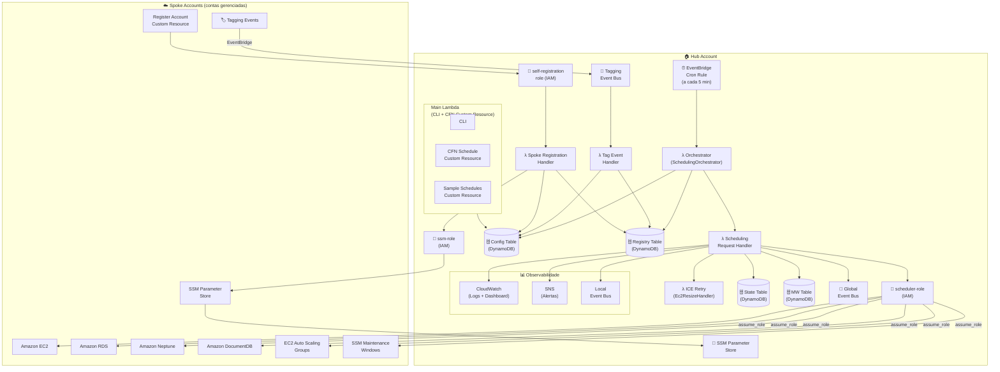

# AWS Instance Scheduler on AWS — Estudo Prático


Estudo prático de implantação **manual** da solução oficial da AWS **Instance Scheduler on AWS** em uma conta Sandbox. Em vez do deploy automático via CloudFormation, todos os recursos foram criados individualmente no console AWS, com o objetivo de compreender cada serviço, sua configuração e as dependências entre eles.

---

## Sobre a Solução

O **Instance Scheduler on AWS** é uma solução open-source mantida pela AWS que automatiza o **start e stop de instâncias EC2, RDS e Auto Scaling Groups** com base em agendamentos configuráveis. O objetivo principal é reduzir custos operacionais parando recursos fora do horário de uso.

| | |
|---|---|
| **Solução oficial** | [aws.amazon.com/solutions — Instance Scheduler](https://aws.amazon.com/solutions/implementations/instance-scheduler-on-aws/) |
| **Repositório original** | [aws-solutions-library-samples/instance-scheduler-on-aws](https://github.com/aws-solutions-library-samples/instance-scheduler-on-aws) |
| **Versão estudada** | v3.2.15 |
| **Referência de deploy** | `instance-scheduler-on-aws.template` (CloudFormation, 8067 linhas) |

---

## Arquitetura

A solução é baseada no padrão **Hub-and-Spoke**: uma conta central (Hub) gerencia o agendamento de recursos em uma ou várias contas gerenciadas (Spokes).



---

## Serviços AWS Praticados

| Serviço | O que foi configurado manualmente |
|---|---|
|  | Customer Managed Key com rotação automática e key policy customizada |
|  | 4 tabelas com criptografia KMS, PITR habilitado e DynamoDB Streams |
|  | 15 funções Python 3.12 com roles, variáveis de ambiente e log groups |
|  | 2 event buses customizados e 4 regras (cron + tag events) |
|  | 19 roles com trust policies, incluindo cross-account via STS |
|  | Topic criptografado com topic policy restritiva (SSL-only) |
|  | 3 filas (1 principal + 2 DLQs) com KMS e visibility timeout |
|  | Log groups, subscription filters, dashboard operacional e Insights queries |
|  | assume_role para execução cross-account |
|  | State machine de polling assíncrono para custom resources |
|  | Parameter Store para registro de regiões gerenciadas |

---

## Estrutura do Repositório

```
.
├── README.md                               # Este arquivo
├── ANALISE_PROJETO.md                      # Análise técnica detalhada da solução
├── instance-scheduler-on-aws.template     # Template CloudFormation original (referência)
├── guide.pdf                               # Guia oficial da solução AWS
│
├── docs/
│   └── GUIA_EXECUCAO_MANUAL.md            # 15 etapas de criação manual dos recursos
│
└── evidencias/
    ├── README.md                           # Guia de organização das evidências
    ├── 01-kms/
    ├── 02-dynamodb/
    ├── 03-cloudwatch-logs/
    ├── 04-sns/
    ├── 05-sqs/
    ├── 06-eventbridge/
    ├── 07-iam/
    ├── 08-lambda/
    ├── 09-eventbridge-rules/
    ├── 10-stepfunctions/
    ├── 11-inicializacao/
    ├── 12-dashboard/
    └── 13-validacao/
```

> O código-fonte original não está incluído neste repositório.
> Acesse em: [github.com/aws-solutions-library-samples/instance-scheduler-on-aws](https://github.com/aws-solutions-library-samples/instance-scheduler-on-aws)

---

## Progresso da Execução

| # | Etapa | Serviço | Status |
|---|---|---|---|
| 1 | KMS Key e Alias | KMS | ✅ Concluído |
| 2 | DynamoDB Tables (4) | DynamoDB | ✅ Concluído |
| 3 | CloudWatch Log Groups | CloudWatch | ✅ Concluído |
| 4 | SNS Topic | SNS | ✅ Concluído |
| 5 | SQS Queues | SQS | ✅ Concluído |
| 6 | EventBridge Event Buses | EventBridge | ✅ Concluído |
| 7 | IAM Roles e Policies | IAM | ⏳ Pendente |
| 8 | Lambda Functions (15) | Lambda | ⏳ Pendente |
| 9 | Lambda Permissions e ESM | Lambda / SQS | ⏳ Pendente |
| 10 | EventBridge Rules | EventBridge | ⏳ Pendente |
| 11 | CloudWatch Subscription Filters | CloudWatch | ⏳ Pendente |
| 12 | Step Functions State Machine | Step Functions | ⏳ Pendente |
| 13 | Inicialização via CloudShell | Lambda / DynamoDB | ⏳ Pendente |
| 14 | CloudWatch Dashboard | CloudWatch | ⏳ Pendente |
| 15 | Validação end-to-end com EC2 | EC2 | ⏳ Pendente |

---

## Aprendizados

> *Seção preenchida ao longo da execução*

- [ ] Como uma Customer Managed Key (KMS) centraliza criptografia em múltiplos serviços
- [ ] Diferença entre Partition Key simples e composta no DynamoDB
- [ ] Como IAM Roles cross-account funcionam via STS assume_role
- [ ] Como EventBridge cron expressions disparam Lambdas em intervalos fixos
- [ ] Como o padrão Hub-and-Spoke escala o gerenciamento para múltiplas contas AWS
- [ ] Validar o fluxo completo de agendamento via CloudWatch Logs

---

## Referências

- [AWS Instance Scheduler — Implementation Guide](https://docs.aws.amazon.com/solutions/latest/instance-scheduler-on-aws/solution-overview.html)
- [Repositório original — aws-solutions-library-samples](https://github.com/aws-solutions-library-samples/instance-scheduler-on-aws)
- [AWS CloudFormation User Guide](https://docs.aws.amazon.com/AWSCloudFormation/latest/UserGuide/Welcome.html)
- [AWS IAM — Cross-account roles](https://docs.aws.amazon.com/IAM/latest/UserGuide/tutorial_cross-account-with-roles.html)
- [Amazon EventBridge — Cron expressions](https://docs.aws.amazon.com/eventbridge/latest/userguide/eb-scheduled-rule-pattern.html)
